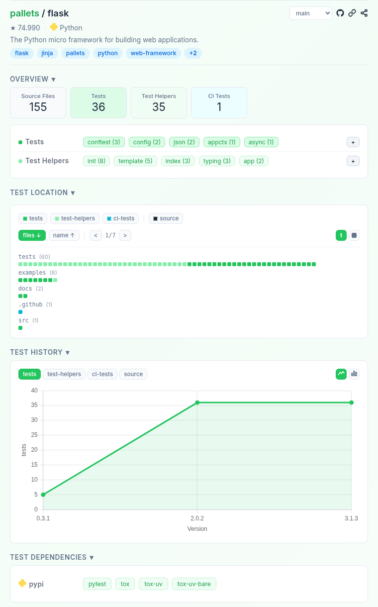

# Explorando Práticas de Teste

Neste exercício, vamos explorar práticas de teste em sistemas reais utilizando a ferramenta [TestMiner](https://andrehora.github.io/testminer).

O TestMiner permite visualizar e analisar testes de software em repositórios do GitHub, fornecendo dados sobre como os projetos organizam seus testes, como eles evoluem entre versões e quais bibliotecas de teste são utilizadas.
Explore a ferramenta antes de começar para se familiarizar com seu funcionamento.

Mais detalhes no GitHub da ferramenta: https://github.com/andrehora/testminer.

---

## Passo 1: Selecionar um repositório

Escolha um repositório real que possua testes de software.
Abaixo estão alguns links para ajudá-lo a encontrar projetos interessantes:

- Python: https://github.com/topics/python?l=python
- JavaScript: https://github.com/topics/javascript?l=javascript
- TypeScript: https://github.com/topics/typescript?l=typescript
- Java: https://github.com/topics/java?l=java

- Tópicos: [ai](https://andrehora.github.io/testminer/#topic:ai), [llm](https://andrehora.github.io/testminer/#topic:llm), [api](https://andrehora.github.io/testminer/#topic:api), [nodejs](https://andrehora.github.io/testminer/#topic:nodejs), [android](https://andrehora.github.io/testminer/#topic:android)

- Por organização: [Google](https://andrehora.github.io/testminer/#google), [Microsoft](https://andrehora.github.io/testminer/#microsoft), [Apple](https://andrehora.github.io/testminer/#apple), [Facebook](https://andrehora.github.io/testminer/#facebook), [Netflix](https://andrehora.github.io/testminer/#netflix), 
[GitHub](https://andrehora.github.io/testminer/#github), [Apache](https://andrehora.github.io/testminer/#apache), [HuggingFace](https://andrehora.github.io/testminer/#huggingface)

## Passo 2: Explorar o repositório selecionado

Busque o repositório escolhido no [TestMiner](https://andrehora.github.io/testminer) e analise os dados de teste gerados pela ferramenta.

## Passo 3: Explicar uma prática de teste

Escolha uma prática ou dado de teste relevante e explique com suas próprias palavras.

---

## Instruções de entrega

1. Faça um `fork` deste repositório (saiba mais sobre forks [aqui](https://docs.github.com/pt/pull-requests/collaborating-with-pull-requests/working-with-forks/fork-a-repo)).
2. Responda às questões abaixo diretamente neste arquivo `README.md` do seu fork. Pode adicionar imagens para enriquecer sua explicação.
3. No Moodle, submeta apenas a URL do seu fork.

---

## Respostas

Repositório: https://github.com/pallets/flask

URL TestMiner: https://andrehora.github.io/testminer/#pallets/flask



### Explicação

**Prática escolhida: uso de *fixtures* do pytest centralizadas em arquivos `conftest.py` (Test Helpers).**

#### O que o TestMiner mostra

Na branch `main`, o TestMiner classifica os arquivos do Flask da seguinte forma:

| Categoria    | Arquivos |
|--------------|---------:|
| Source Files | 155      |
| Tests        | 36       |
| Test Helpers | 35       |
| CI Tests     | 1        |

Dois pontos chamam a atenção:

1. **O número de *Test Helpers* (35) é praticamente igual ao de *Tests* (36).** Ou seja, para cada arquivo de teste existe, em média, um arquivo de apoio (aplicações de exemplo em `tests/test_apps/`, templates, arquivos de configuração, `__init__.py` etc.). Isso mostra que testar um framework web exige montar bastante "cenário" ao redor do teste.
2. **O termo mais frequente entre os testes é `conftest` (3 arquivos)**: `tests/conftest.py`, `examples/tutorial/tests/conftest.py` e `examples/javascript/tests/conftest.py`. Na seção *Test Dependencies*, a ferramenta também mostra que o projeto usa **pytest** (e **tox** para rodar os testes em vários ambientes).

#### O que é um `conftest.py` e por que ele importa

No pytest, uma *fixture* é uma função que prepara algo que o teste precisa (um objeto, um contexto, um ambiente limpo) e, opcionalmente, desfaz essa preparação depois. O arquivo `conftest.py` é um arquivo especial: o pytest o carrega automaticamente, e todas as fixtures definidas nele ficam disponíveis para todos os testes daquela pasta, **sem precisar de `import`**.

No Flask, o [`tests/conftest.py`](https://github.com/pallets/flask/blob/main/tests/conftest.py) define fixtures como:

```python
@pytest.fixture
def app():
    app = Flask("flask_test", root_path=os.path.dirname(__file__))
    app.config.update(TESTING=True, SECRET_KEY="test key")
    return app

@pytest.fixture
def client(app):
    return app.test_client()
```

E os testes simplesmente declaram o que precisam como parâmetro — o pytest injeta as fixtures pelo nome ([`tests/test_basic.py`](https://github.com/pallets/flask/blob/main/tests/test_basic.py)):

```python
def test_options_work(app, client):
    @app.route("/", methods=["GET", "POST"])
    def index():
        return "Hello World"

    rv = client.open("/", method="OPTIONS")
    assert sorted(rv.allow) == ["GET", "HEAD", "OPTIONS", "POST"]
```

Repare que `client` depende de `app`: fixtures podem ser compostas umas com as outras. Cada teste recebe uma aplicação **nova e isolada**, então um teste não interfere no outro.

O `conftest.py` do Flask também usa fixtures com `autouse=True`, que rodam em **todos** os testes automaticamente:

- `_standard_os_environ`: remove variáveis de ambiente como `FLASK_APP` e `FLASK_DEBUG` antes de cada teste, garantindo que o resultado não dependa da máquina de quem está rodando;
- `leak_detector`: depois de cada teste, verifica se algum contexto da aplicação ficou "aberto" e falha o teste se isso acontecer — uma forma de detectar vazamento de estado entre testes.

#### Por que essa é uma boa prática

- **Evita repetição:** a criação da aplicação e do cliente de teste fica em um único lugar, em vez de ser copiada nos 22 arquivos `test_*.py` da pasta `tests/`.
- **Isolamento:** cada teste começa com um estado limpo e previsível, o que reduz testes "flaky" (que às vezes passam, às vezes falham).
- **Legibilidade:** o corpo do teste fica focado só no comportamento que está sendo verificado.
- **Facilidade de manutenção:** se a forma de criar a aplicação mudar, basta alterar a fixture.

#### Evolução ao longo das versões

Navegando pelas versões no TestMiner, dá para ver o conjunto de testes crescer junto com o projeto e o `conftest` aparecer como prática consolidada:

| Versão | Source Files | Tests | Test Helpers | CI Tests |
|--------|-------------:|------:|-------------:|---------:|
| 0.1    | 33           | 4     | 3            | –        |
| 0.10   | 138          | 15    | 54           | –        |
| 0.12   | 146          | 29    | 21           | –        |
| 1.0    | 138          | 31    | 31           | –        |
| 2.0.0  | 148          | 36    | 31           | 1        |
| 3.1.3  | 154          | 36    | 35           | 1        |

Na versão 0.1, o Flask tinha só 4 arquivos de teste. A partir da **1.0**, o termo `conftest (3)` passa a ser o mais frequente entre os testes, mostrando que o projeto adotou as fixtures do pytest como padrão de organização. Na **2.0.0** aparece também um arquivo de **CI Tests** (`.github/workflows/tests.yaml`), ou seja, os testes passaram a rodar automaticamente no GitHub Actions a cada mudança. Desde então, o número de testes se manteve estável (~36 arquivos), o que sugere um projeto maduro, em que novos casos de teste são adicionados nos arquivos já existentes, em vez de criar arquivos novos.
